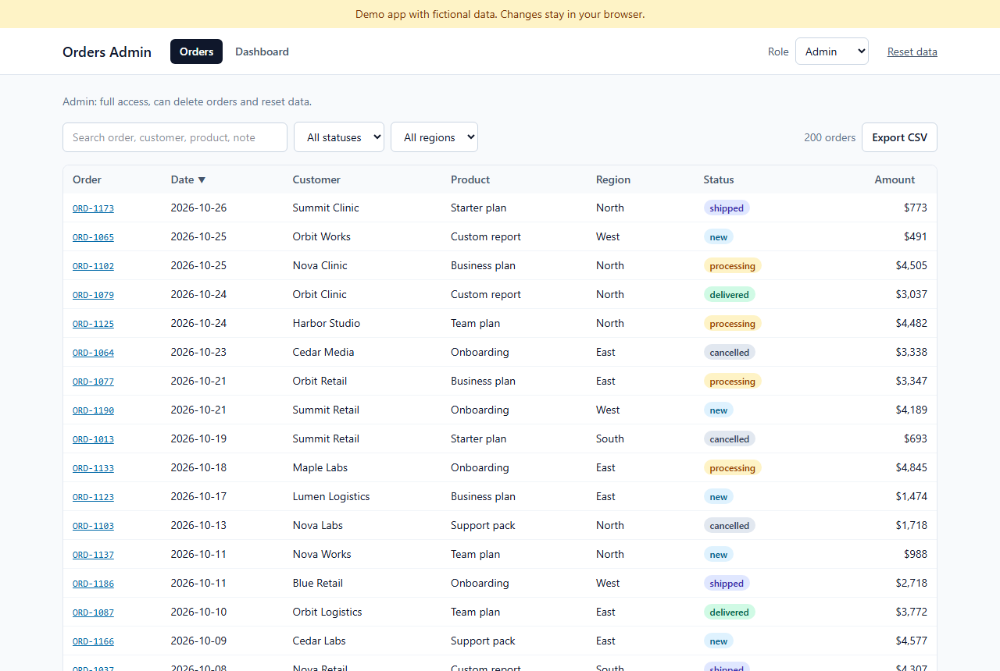

# Orders Admin demo

A small admin panel for orders, built with React, TypeScript and Tailwind. All data is fictional and generated in the browser. There is no backend.

**Live demo:** https://yeldos13.github.io/Admin-panel/



## Features

- Orders table with search, status and region filters, sorting and pagination
- Card layout on phones
- Edit form with validation
- Three roles: admin edits everything and can delete, manager changes status and notes, viewer only reads
- CSV export of the filtered table
- Dashboard with revenue, order count, average order and charts by month, region and status
- Changes are saved in localStorage; "Reset data" restores the original set

The roles only change what the UI shows. In a real app the server would check permissions.

## Run locally

```bash
npm install
npm run dev
```

`npm test` runs the unit tests for filtering, sorting, permissions, validation, CSV and stats. `npm run build` builds into `dist`. Every push to `main` is deployed to GitHub Pages by `.github/workflows/pages.yml`.

## Stack

React 19, TypeScript, Vite, Tailwind CSS 4, Recharts, Vitest.
